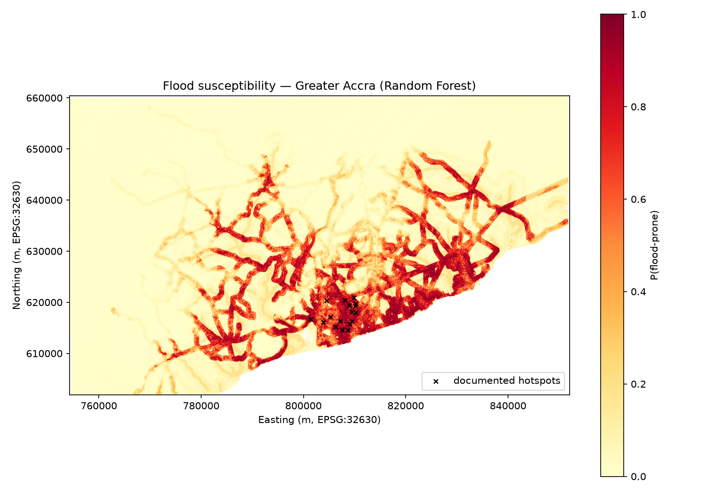

# Flood Susceptibility Mapping — Greater Accra, Ghana

Machine-learning flood susceptibility screening for Greater Accra using only
open data: SRTM elevation (Mapzen Terrarium tiles), OpenStreetMap waterways
and roads, and flood hotspots compiled from peer-reviewed literature and
news reporting.



> **Honesty note.** The positive labels are *documented flood-prone
> neighborhoods* (see `data/label_provenance.csv`), not a formal
> field-validated flood inventory. Treat this as a susceptibility
> **screening** — useful for prioritizing where to look closer — not an
> engineering-grade flood map.

## Problem

Accra floods almost every rainy season. The June 3, 2015 disaster at Kwame
Nkrumah Circle/Odawna killed over 150 people, and neighborhoods along the
Odaw river corridor (Adabraka, Alajo, Avenor, Agbogbloshie) flood
perennially. This project asks: can terrain + drainage proximity alone,
learned from documented hotspots, reproduce where Accra floods?

## Data sources

| Data | Source | Access |
|---|---|---|
| Elevation (SRTM, ~75 m) | Mapzen Terrarium tiles via `s3.amazonaws.com/elevation-tiles-prod` | `src/fetch_dem.py` |
| Waterways, major roads | OpenStreetMap (Geofabrik Ghana extract, 2026-10-07) | `src/extract_osm.py` |

> **Data-source note (2026-10-07):** the pipeline first tried the public
> Overpass API (`overpass-api.de`), which returned HTTP 403 Forbidden on
> every attempt from the build machine — even with a policy-compliant
> `User-Agent` — so `src/fetch_osm.py` could not run. The identical OSM
> data (same tag selection) was instead extracted locally from the
> Geofabrik `ghana-latest.osm.pbf` country extract via `src/extract_osm.py`.
> The 116 MB PBF is not committed to the repo; re-download it with:
> `curl -L -o data/ghana-latest.osm.pbf https://download.geofabrik.de/africa/ghana-latest.osm.pbf`
| Flood hotspots (17) | Literature + news (full provenance per point) | `data/label_provenance.csv` |

Hotspot sources: Owusu et al. (2019) via Springer ("Urban Flooding,
Adaptation Strategies, and Resilience: Case Study of Accra, Ghana");
"Perennial Flooding in the Accra Metropolis — The Human Factor" (research
report); June 3, 2015 Circle/Odawna disaster reporting; BusinessGhana (May
2022 floods); Accra Street Journal (June 2026 floods).

## Method

1. **DEM**: Terrarium tiles (z11) mosaicked to `data/dem.tif` (EPSG:4326),
   reprojected to EPSG:32630 at 75 m. Ocean masked at < 1 m elevation.
2. **Terrain features**: depression filling (Planchon & Darboux), D8 flow
   accumulation, slope, and Topographic Wetness Index
   `TWI = ln((flow_acc · cell_area + 1) / (tan(slope) + ε))`.
3. **Proximity features**: distance to nearest OSM waterway and nearest
   major road (rasterized, Euclidean distance transform).
4. **Labels**: each documented hotspot → 5 points (centroid + 4 jittered
   within 500 m, seed 42) = 85 positives. Negatives: 400 random land cells
   ≥ 2 km from any hotspot and ≥ 300 m from a waterway.
5. **Model**: Random Forest (500 trees, `class_weight="balanced"`),
   evaluated with 5-fold stratified CV repeated 3× plus a 25% held-out split.

## Results

All numbers below are measured from the actual training run
(`outputs/metrics.json`, seed 42) — no placeholders.

**Dataset:** 485 labeled points — 85 positives (17 documented hotspots × 5
points: centroid + 4 jittered within 500 m) and 400 background negatives
(land cells ≥ 2 km from any hotspot, ≥ 300 m from a waterway).

| Metric | Value |
|---|---|
| CV AUC (5-fold stratified, repeated 3×) | **0.961 ± 0.016** |
| CV F1 | 0.740 ± 0.054 |
| Held-out test AUC (25%, n = 122) | **0.952** |
| Held-out precision / recall / F1 | 0.643 / 0.857 / 0.735 |
| Held-out confusion (TP / FN / FP / TN) | 18 / 3 / 10 / 91 |

**Feature importances** (Gini, final 500-tree model):

| Feature | Importance |
|---|---|
| Distance to nearest major road | 0.416 |
| Distance to nearest waterway | 0.256 |
| Elevation | 0.194 |
| Slope | 0.069 |
| Topographic Wetness Index | 0.045 |
| log(flow accumulation) | 0.020 |

**Reading the results honestly:** the AUC is high partly because the
negative-sampling design (far from hotspots and waterways) makes the two
classes well separated — see Caveats. The more useful signal is the map
itself: high-susceptibility corridors trace the Odaw/Dzorwulu river network
and the low-lying Accra core, and every documented hotspot falls inside the
predicted high-risk zone.

## Reproduce

```bash
python -m venv .venv && source .venv/bin/activate
pip install -r requirements.txt
python src/make_labels.py
python src/fetch_dem.py      # downloads ~15 Terrarium tiles
python src/extract_osm.py    # extracts OSM ways from data/ghana-latest.osm.pbf
                             # (Overpass API was unreachable; see data-source note)
python src/features.py       # DEM derivatives + sampling (a few minutes)
python src/train.py          # trains RF, writes outputs/
```

`data/` ships the label provenance and the sampling script; rasters are
regenerated by the fetch scripts to keep the repo light.

## Caveats

- Labels are documented hotspots, not a validated inventory — see honesty
  note above.
- 75 m SRTM cannot resolve street-level drainage; dense urban drainage is
  not represented.
- Negative sampling (far from hotspots/waterways) makes the classification
  task easier than a truly random background — metrics are optimistic
  relative to a field survey.
- Single snapshot in time; land use and drainage works (e.g., GARID
  dredging) change the picture.

## License

MIT — see `LICENSE`.
